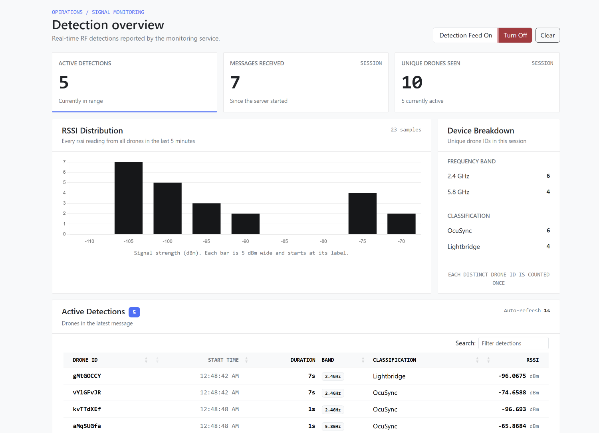
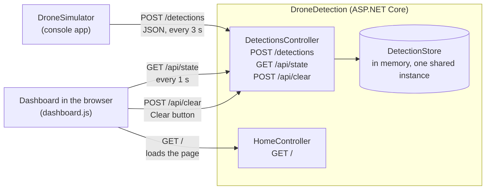

# Drone Detection

Small system with three parts:

1. **DroneSimulator**: a console app that pretends to be a detection service and POSTs a `detections` message every 3 seconds.
2. **DroneDetection**: an ASP.NET Core (.NET 9) MVC app. It receives the messages, keeps everything in memory (no database), and serves a JSON API plus the dashboard page.
3. **UI Dashboard**: a single web page (Bootstrap, DataTables, Chart.js) that asks the API for the latest numbers and draws them.
<p align="center">
  
</p><details>
<summary><h2>Architecture</h2></summary>


| Endpoint | Used by | What it does |
|---|---|---|
| `POST /detections` | simulator | Validates the message and stores it. Returns `204`. Invalid bodies get a `400`. |
| `GET /api/state` | dashboard | Returns everything the page needs in one JSON object. |
| `POST /api/clear` | dashboard | Empties the store. |
| `GET /` | browser | Returns the dashboard page. |

### Project structure

```
DroneDetection/            the API and dashboard
  Controllers/             HomeController (page), DetectionsController (JSON)
  Models/                  DetectionMessage, Detection, Reading, HistogramBin, StateResponse
  Services/                DetectionStore (all the logic and in-memory state)
  Views/                   _Layout.cshtml, Home/Index.cshtml
  wwwroot/                 css/site.css, js/dashboard.js
DroneSimulator/            the console app that sends messages
  DetectionSimulator.cs    the rules for each message
  RandomValues.cs          random ids and rssi values
tests/                     xUnit tests
```

</details>

<details >
<summary><h2>How to run</h2></summary>

### 1. Install the .NET 9 SDK

Download it from <https://dotnet.microsoft.com/download/dotnet/9.0> (choose **SDK**, not Runtime), run the installer, then check it worked:

```
dotnet --version
```

Visual Studio is **optional**. Everything below runs from a terminal with just the .NET 9 SDK.
If you prefer an IDE, Visual Studio 2022 (17.12 or newer, with the "ASP.NET and web development"
workload) or VS Code with the C# Dev Kit both work.

### 2. Get the code and build

```
git clone https://github.com/nmatute/av_titan.git
cd av_titan/dot_net
dotnet build
```

### 3. Trust the HTTPS development certificate (once)

The API listens on HTTPS, so run this once and accept the prompt:

```
dotnet dev-certs https --trust
```

### 4. Start the API

```
dotnet run --project DroneDetection
```

Wait for the line `Now listening on: https://localhost:7052`, then open **<https://localhost:7052>** in a browser. The dashboard is empty until the simulator starts.

> The address comes from `DroneDetection/Properties/launchSettings.json` (`applicationUrl`). If your API prints a different port, use that port everywhere below.

### 5. Start the simulator (in a second terminal)

```
dotnet run --project DroneSimulator
```

The simulator **must post to the same address the API is listening on**. Its default is set at the top of `DroneSimulator/Program.cs`:

```csharp
string apiUrl = "https://localhost:7052/detections";
```

You can also pass the address (and the interval in seconds) without editing code:

```
dotnet run --project DroneSimulator -- https://localhost:7052/detections 3
```

Each line it prints should end in `-> 204`. Within a few seconds the dashboard starts filling in.

### Running both from Visual Studio

Right-click the solution → **Configure Startup Projects** → **Multiple startup projects** → set `DroneDetection` and `DroneSimulator` to **Start**, with `DroneDetection` listed first. Pick the `https` profile for the API and press **F5**.

### Run the tests

```
dotnet test
```

### Troubleshooting

| Symptom | Cause / fix |
|---|---|
| Simulator prints `POST failed: ... actively refused it` | The API isn't running, or the simulator's URL and port don't match the API's. |
| Simulator prints a certificate / SSL error | Run `dotnet dev-certs https --trust`, then restart both programs. |
| Simulator prints `-> 400` | The API rejected the message. The body didn't match the expected format. |
| Dashboard shows "Can't reach the API" | The API isn't running. |
| Dashboard is empty but the API receives messages | Open the browser console (F12) and look for a red error. The page loads libraries from CDNs, so it needs an internet connection. |

</details>

<details>
<summary><h2>Sample JSON</h2></summary>

### What the simulator sends (`POST /detections`)

```json
{
  "msg_type": "detections",
  "system": "detection_service",
  "msg_id": "kQhZpwrT",
  "timestamp": "1712010300",
  "detections": [
    {
      "drone_id": "aBcDeFgH",
      "start_time": 1712010285,
      "band": "2.4GHz",
      "classification": "OcuSync",
      "rssi": -87.3412
    },
    {
      "drone_id": "mNoPqRsT",
      "start_time": 1712010300,
      "band": "5.8GHz",
      "classification": "Lightbridge",
      "rssi": -72.0185
    }
  ]
}
```

### What the dashboard receives (`GET /api/state`)

```json
{
  "messageCount": 12,
  "active": [
    {
      "drone_id": "aBcDeFgH",
      "start_time": 1712010285,
      "band": "2.4GHz",
      "classification": "OcuSync",
      "rssi": -87.3412
    }
  ],
  "bands": { "2.4GHz": 3, "5.8GHz": 2 },
  "classes": { "OcuSync": 4, "Lightbridge": 1 },
  "histogram": [
    { "low": -110, "high": -105, "count": 0 },
    { "low": -105, "high": -100, "count": 2 },
    { "low": -100, "high": -95, "count": 5 }
  ],
  "serverTime": 1712010300
}
```

`histogram` has 9 entries in the real response (shortened here). `bands` and `classes` count each distinct `drone_id` once.

</details>

<details>
<summary><h2>How the pieces work</h2></summary>

### The simulator (`DroneSimulator`)

It builds one message every 3 seconds, using a `PeriodicTimer` so the rate doesn't drift. For each message it follows these rules:

1. **Existing drones:** each drone from the previous message has an **80% chance** of appearing again (`SurvivalRate = 0.8`). A drone that drops out never comes back.
2. **Signal strength:** a drone that stays gets a new `rssi` within **±3 dBm** of its previous value, so readings stay similar. It always changes, stays between **-110 and -65**, and is rounded to **4 decimals** (`RandomValues.NextRssi`).
3. **New drones:** **0 to 2** new drones appear. Each gets a unique 8-letter `drone_id`, a random `band` (`2.4GHz` / `5.8GHz`) and `classification` (`OcuSync` / `Lightbridge`), and `start_time` = this message's timestamp. Band, classification and start time never change for that drone.
4. **Never empty:** if nothing survived and nothing spawned, one drone is added, so a message always has at least one detection.
5. **Fixed fields:** `msg_type` is always `"detections"`, `system` is always `"detection_service"`, `msg_id` is a unique 8-letter string, and `timestamp` is sent as a string.

`DetectionSimulator` takes an optional seeded `Random`, so the tests can generate the same drones every run.

### The store (`DetectionStore`)

All state lives in memory in one class, registered as a **singleton** (`AddSingleton<DetectionStore>()`). The controller is created fresh for every request, so the data has to live in a service that lives for the whole app.

It keeps **three collections**, one for each question the dashboard asks:

| Field | Holds | Used for |
|---|---|---|
| `_active` | the drones in the **latest** message (replaced on every message) | the Active Detections table |
| `_firstSightings` | each `drone_id` once, with its band and classification | top bands and classifications, so a drone counts once however many messages it appears in |
| `_readings` | `{ timestamp, rssi }` for every drone in every message | the 5-minute histogram |

Key details:

- **Thread safety.** Requests can arrive at the same moment, so every method takes a `lock` and the requests take turns.
- **Testable time.** The store asks an injected `TimeProvider` for the time instead of calling `DateTime.Now`. The app uses the real clock, and the tests pass in a `FakeTimeProvider` they can move forward.
- **Memory stays small.** After each message, readings older than 5 minutes (300 seconds) are removed. Readings are added in time order, so the oldest are at the front and the cleanup removes from the front until it reaches a recent one.
- **The histogram** has 9 bins, each 5 dBm wide, from -110 to -65. For each reading from the last 5 minutes, the bin number is:

  ```
  index = floor((rssi - (-110)) / 5)        // for example -87 -> floor(23 / 5) = bin 4  (-90 to -85)
  ```

  A reading of exactly -65 would give 9, which is past the last bin, so it is placed in the last bin (8).
- **Bands and classifications** are counted from `_firstSightings`, so each distinct drone is counted once.

### The dashboard (`wwwroot/js/dashboard.js`)

- **Polling.** `setInterval` calls `tick()` every second. `tick()` fetches `GET /api/state` with `$.ajax`, then `render()` draws everything from that one JSON object.
- **The table** is a DataTables table created once. On each update the rows are replaced with `clear().rows.add(rows).draw()`, which keeps the user's search text and sort order.
- **Duration** isn't sent by the API. The browser computes it as *current server time − `start_time`*. To stay accurate even if the computer's clock is off, it stores the difference between `serverTime` and its own clock (`clockOffset`). Because `render()` runs every second, durations count up smoothly.
- **The histogram** is a Chart.js bar chart created once. Each update replaces its labels and data and calls `chart.update()`.
- **Device Breakdown** has four fixed rows (2.4 GHz, 5.8 GHz, OcuSync, Lightbridge). The JavaScript only fills in the numbers (`renderBreakdown`), using `|| 0` for anything not seen yet.
- **Feed on/off.** The *Turn Off* button stops the polling and freezes the durations. *Turn On* resumes.
- **Clear** sends `POST /api/clear`, then reloads the state.
- **Error box.** If a request fails, a red "Can't reach the API" message appears, and it disappears again when requests work.

</details>
<details>
<summary><h2>Tests</h2></summary>

### How to run the tests

From the solution folder (the one containing the `.sln` file):

```
dotnet test
```

You do **not** need to start the API or the simulator first. The tests are self-contained.

The tests are in `tests/DroneTests` and use [xUnit](https://xunit.net/). They need the packages `Microsoft.AspNetCore.Mvc.Testing` (to start the API in memory) and `Microsoft.Extensions.TimeProvider.Testing` (for the fake clock). Both are already listed in the test project.

### What is tested

| Test class | Tests | What it covers |
|---|---|---|
| `DetectionSimulatorTests` | 2 | The simulator's output: the right JSON field names and values, ids never reused, drones that stay keep their details, rssi changes by at most 3 and stays in range, no more than 2 new drones per message |
| `DetectionStoreTests` | 5 | The store's logic: message count, active drones, each drone counted once, histogram bins, the 5-minute window, clear |
| `DetectionsApiTests` | 6 tests | The real API over HTTP: accepting valid messages, rejecting bad ones, counting, clearing |

**`DetectionSimulatorTests`**

- `GenerateMessage_SerializesExpectedApiFields`: checks the JSON the API would receive: `msg_type`, `system`, a string `timestamp`, 8-letter ids, allowed bands and classifications, rssi between -110 and -65.
- `GenerateMessage_PreservesSurvivorsAndDoesNotReuseIds`: generates 40 messages in a row and checks that ids are never reused, a drone that stays keeps its start time, band and classification, its rssi changes (but by no more than 3), rssi has at most 4 decimals, messages are never empty, and at most 2 new drones appear at a time.

**`DetectionStoreTests`**

- `Counts_messages_and_keeps_only_the_latest_drones_as_active`: the counter goes up for each message, and only the latest message's drones are active.
- `Counts_each_drone_once_by_band_and_classification`: a drone seen in many messages is counted once in the breakdown.
- `Histogram_puts_each_reading_in_its_bin`: readings land in the right 5 dBm bar, including the edges at -110 and -65.
- `Histogram_ignores_readings_older_than_five_minutes`: old readings stop counting after 5 minutes (using a fake clock, so the test doesn't have to wait).
- `Clear_resets_everything`: clearing empties the counters, the table, the breakdown and the histogram.

**`DetectionsApiTests`**

- `Valid_message_returns_204_and_shows_up_in_the_state`: a valid message is accepted and appears in `GET /api/state`.
- `Timestamp_can_be_a_string_or_a_number` (2 cases): both "1712010300" and 1712010300 are accepted.
- `Bad_messages_return_400` (4 cases): a wrong msg_type, a timestamp that isn't a number, an empty drone_id and a null rssi are all rejected.
- `Broken_or_incomplete_bodies_return_400` (2 cases): text that isn't JSON, and a message with no detections list, are rejected.
- `Same_drone_in_two_messages_is_counted_once_in_the_bands`: the same drone sent twice counts as one drone.
- `Clear_empties_the_state`: `POST /api/clear` resets the state.

### How the tests stay reliable

- **A fake clock.** The store asks a TimeProvider for the time. The tests give it a FakeTimeProvider that they can move forward, so the 5-minute window can be tested instantly.
- **A seeded `Random`.** The simulator tests pass `new Random(42)`, so every run produces exactly the same drones.
- **A fresh app per test.** Each API test starts its own copy of the app, so tests never share data or depend on running in a particular order.

</details>
<details>
<summary><h2>UI design</h2></summary>

Figma: <https://www.figma.com/design/R7VzvHpJtvWwAYYId6L0CF/Drone-Detection?node-id=0-1&t=oRSzjZseclp2gmti-1>

The page uses Bootstrap 5 for layout and styling and some custom CSS for the cards only (`wwwroot/css/site.css`).

</details>

<details>
<summary><h2>Design decisions and trade-offs</h2></summary>

- **No database.** Everything is in memory, as requested. Restarting the API resets all data.
- **Polling, not push.** The page asks for new data every second. It's the simplest approach and fits the 3-second message rate. SignalR or server-sent events would remove the polling but add moving parts.
- **One endpoint for the whole dashboard.** `GET /api/state` returns everything in one response, so the page never shows half-updated numbers.
- **The server computes the histogram.** The browser receives ready-made bins, so the binning logic is in C# where it can be unit-tested.
- **Simulator as a console app.** It's separate from the API, so it behaves like a real external sender that could be pointed at any address.

</details>

<details>
<summary><h2>Issues encountered</h2></summary>

- **Switching stacks.** I built a first version in Python, then rebuilt it in C# / .NET (the stack I work in every day) so I can confidently explain and extend it.
- **Simulator "connection refused".** The API was listening on `https://localhost:7052`, but the simulator was posting to `http://localhost:3000`. Fixed by making the simulator's URL match the API's address.
- **Timestamp is a string.** The spec sends `timestamp` as a string, but the model stores a number. Fixed with `JsonNumberHandling.AllowReadingFromString`.
- **Histogram edge case.** An rssi of exactly -65 works out to bin 9, but there are only bins 0 to 8. It is now placed in the last bin instead of causing an error.

</details>
